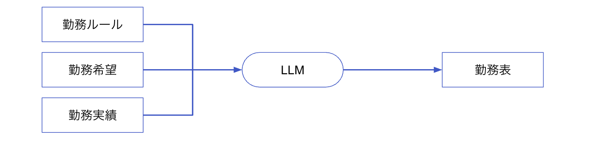
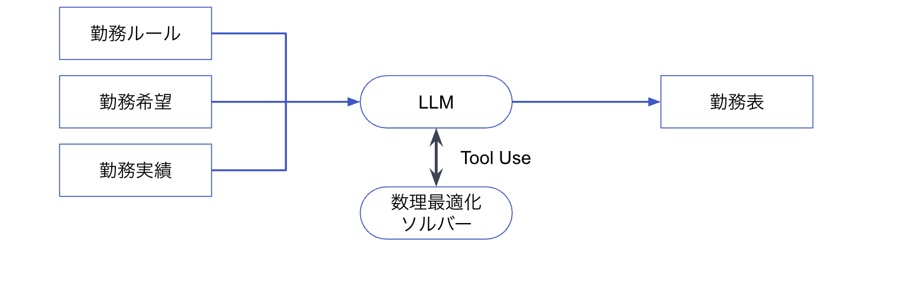
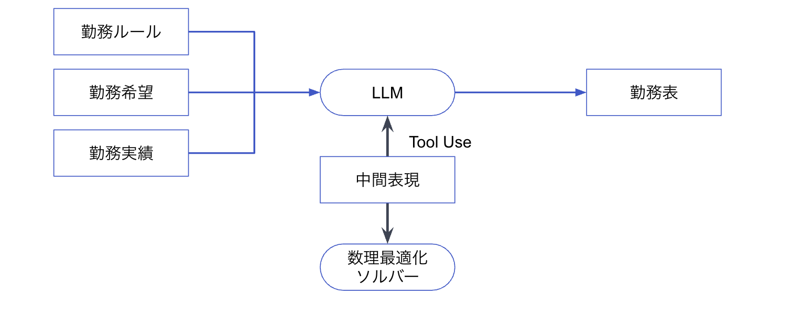
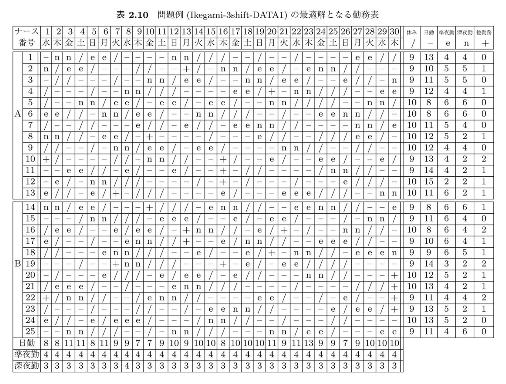
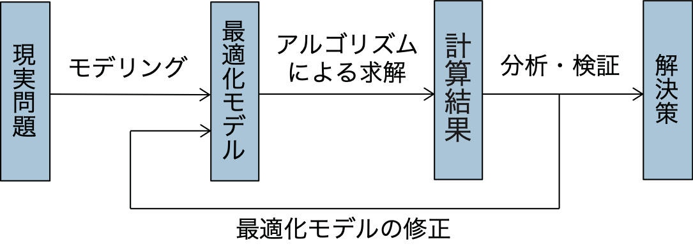
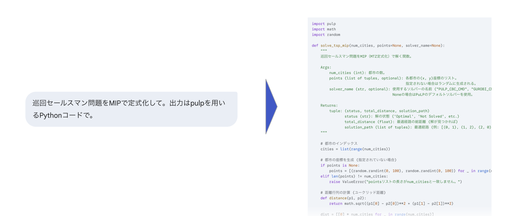
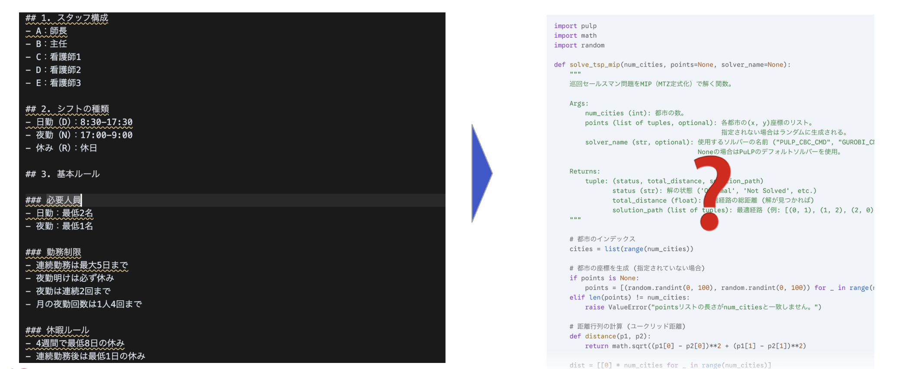
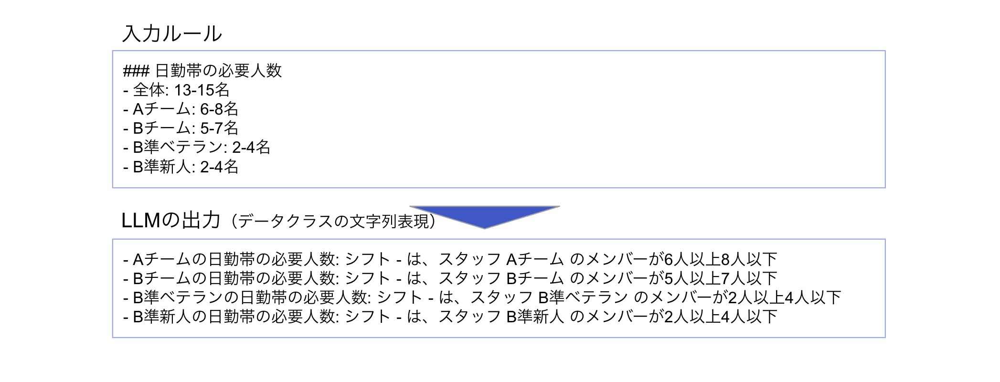
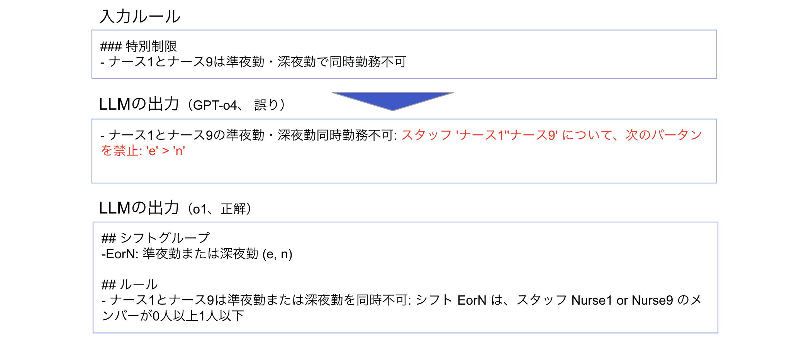
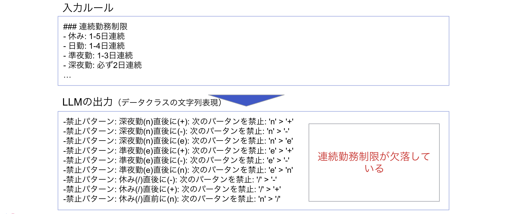

<!-- _class: cover -->

# 大規模言語モデルを用いた<br>自然言語入力による看護師勤務表生成手法の検討

<u>太田 満久</u>, 風間 正弘, 西林 孝
Ubie株式会社

---

## 全体像

**やりたいこと:** LLMを用いて、自然言語で書かれた勤務ルールから勤務表を生成
**手法:** LLMが直接勤務ルールを出力する
**課題:** 現在のLLMでは、複雑なルールを守った勤務表を直接出力することはできない



---

## 全体像

**やりたいこと:** LLMを用いて、自然言語で書かれた勤務ルールから勤務表を生成
**手法:** LLMが数理最適化ソルバーを直接利用し、勤務ルールを出力する（直接定式化）
**課題:** 数理最適化ソルバーを利用する際に抜け漏れ、間違いが発生



---

## 全体像

**やりたいこと:** LLMを用いて、自然言語で書かれた勤務ルールから勤務表を生成
**提案手法:** 中間表現と構造化出力を利用し、利用可能な機能を制限（分離アプローチ）
**期待効果:** 間違いや抜け漏れの抑制と、ルール遵守の確認が容易化



---

## 背景: 看護師の勤務表作成は複雑で煩雑

看護師の勤務表作成においては、法的な要件に加え、ガイドラインや病院・部署特有のローカルルールを守る必要がある

- **法的要件**: 労働基準法の遵守（労働時間、休日、休憩時間等）
- **勤務要件**: 夜勤回数の適正化や連続勤務日数・勤務間隔の確保
- **配置要件**: スキルレベルに応じた配置
- **個別対応**: 個人の希望や相性の考慮

---

## 勤務表の例



<center>
<small>出典: ナース・スケジューリング 問題把握とモデリング (近代科学社; 2018)</small>
</center>

---

## 数理最適化による勤務表の自動作成

数理最適化分野において看護師の勤務表自動生成問題は「ナース・スケジューリング問題」と呼ばれ、多くの研究がなされている. ただし、広く実用化され普及しているとは言えない

- **数理最適化:**
  - 与えられた制約条件の下で目的関数を最大化・最小化する解を見つける手法
- **勤務表作成への応用:**
  - 目的関数: 公平性、希望休充足率、ルール逸脱数等
  - 制約条件: 法的要件、スキル、連続勤務上限、必要人数等
- **普及の上での課題:**
  - 既存のツールでは細かいルールに対応できないことが多い
  - 独自に仕組みを開発するにはコストがかかる

---

## 数理最適化の一般的なプロセス

数理最適化を用いた仕組みを独自に開発する場合、専門家とともに改善のループを回す必要がある

- 全てのルールをはじめから洗い出すのは困難
- モデリングや最適化モデルの修正には専門知識が不可欠



<small>

出典: [数理最適化による問題解決の実践的なアプローチ](https://zenn.dev/umepon/articles/50a74c75f32096875d94)

</small>

---

## 数理最適化の一般的なプロセス

数理最適化を用いた仕組みを独自に開発する場合、専門家とともに改善のループを回す必要がある

- 全てのルールをはじめから洗い出すのは困難
- モデリングや最適化モデルの修正には専門知識が不可欠 → <b>LLM にやらせたい</b>


<small>

出典: [数理最適化による問題解決の実践的なアプローチ](https://zenn.dev/umepon/articles/50a74c75f32096875d94)

</small>

---

## 検証1（直接定式化）: LLMで数理最適化のモデリングはできるか？

看護師の勤務表作成問題において、LLMが**直接**数理最適化ソルバーを利用して解を得ることができるか？

- 入力: 自然言語（Markdown形式）で書かれた勤務ルール
- 出力: 数理最適化ソルバーを利用するPythonコード


---

## 検証1（直接定式化）: LLMで数理最適化のモデリングはできるか？

補足: 簡単な問題については、最近のLLMだけで正確にモデリングできることがわかっている



<center>
<small>
Google Gemini 2.5 Pro (preview) の回答結果
</small>
</center>

---

## 検証1（直接定式化）: LLMで数理最適化のモデリングはできるか？

現実的な問題においても、正確にモデリングできるか？



---

## 検証1（直接定式化）: LLMで数理最適化のモデリングはできるか？

- **言語モデル:** OpenAI GPT-4o, o1, o3-mini
- **利用データ** 公開データ（Ikegami-3shift-DATA1）及び独自収集の実際の勤務ルール
- **入力形式:** 人間が理解しやすい形式（Markdown）でルールを記述したもの

    **ルールの記述例**

    ```markdown
    ## 4. 勤務条件
    ### 看護師A
    - 日勤: 月5回まで, 夜勤: 月4回まで ...
    ### 全体ルール
    - 夜勤翌日の日勤は不可, 必要最低人数: 2名
    ```

- **出力形式:** 数理最適化ソルバーを利用するPythonコード

---

## 検証1（直接定式化）: LLMで数理最適化のモデリングはできるか？

**結果**

1. 現実問題に多い複雑な問題については、正しくモデリングできないことが多い
2. 正しくモデリングできているかの確認に専門知識が必要で労力を要する

```python
...
prob.addConstraint(x[7][1]['/'] == 1, name="Nurse7Day1IsOff")

# (h) この他、間隔制約(7日に1回は/がある等)を実装するなら追加
#     例: 任意の7連区間の和が>=1 など
#     ここでは未実装


# 6. 求解の実行
solution_status = prob.solve(pulp.PULP_CBC_CMD(msg=0))
...
```

<center>
<small>
o1 の出力例. 複雑な部分を省略して出力してしまう
</small>
</center>

---

## 検証1（直接定式化）: LLMで数理最適化のモデリングはできるか？

**結果**

1. 現実問題に多い複雑な問題については、正しくモデリングできないことが多い
2. 正しくモデリングできているかの確認に専門知識が必要で労力を要する

```python
# (f) 特別制限: ナース1とナース9は e・n で同時不可
for d in range(1, num_days+1):
    prob.addConstraint(
        x[1][d]['e'] + x[9][d]['e'] <= 1,
        name=f"NoSimul_e_day{d}")
    prob.addConstraint(
        x[1][d]['n'] + x[9][d]['n'] <= 1,
        name=f"NoSimul_n_day{d}")
```

<center>
<small>
上記の条件は「ナース1と9が同時に同じシフトに入らない」ことを表現しているか？
</small>
</center>

---

## 検証2（分離アプローチ）: LLMは適切な中間表現を出力できるか？

- **言語モデル:** OpenAI GPT-4o, o1, o3-mini
- **利用データ** 公開データ（Ikegami-3shift-DATA1）及び独自収集の実際の勤務ルール
- **入力形式:** 人間が理解しやすい形式（Markdown）でルールを記述したもの

    **ルールの記述例**

    ```markdown
    ## 4. 勤務条件
    ### 看護師A
    - 日勤: 月5回まで, 夜勤: 月4回まで ...
    ### 全体ルール
    - 夜勤翌日の日勤は不可, 必要最低人数: 2名
    ```

- **出力形式:** 制約条件を表すデータクラス（**構造化出力**）

---

## 制約条件を表すデータクラスの例

LLMは制約条件に必要なパラメータのみ（以下の例では pattern, staffs）を出力すれば良く、制約の実現方法に関心を払う必要がない

※ コードそのものを出力するのではなく、構造化出力の仕組みを用いる

```python
class ForbiddenShiftPatternPolicy(Policy):
    """禁止シフトパターンに関する制約を表現するクラス
    
    staffs について、 pattern の並び順のシフトは禁止される
    """
    pattern: List[Union[ShiftType, ShiftTypeGroup]] = Field(..., description="禁止するシフトパターン")
    staffs: Optional[List[Union[Staff, StaffGroup]]] = Field(None, description="対象となるスタッフのリスト。
    指定しない場合は全てのスタッフに適用される")
```

---

## 製薬の内容は非専門家が理解可能

適切な `__str__` を実装しておけば、非専門家でも容易に解釈可能

```python
class ForbiddenShiftPatternPolicy(Policy):
    """禁止シフトパターンに関する制約を表現するクラス
    
    staffs について、 pattern の並び順のシフトは禁止される
    """
    pattern: List[Union[ShiftType, ShiftTypeGroup]] = Field(..., description="禁止するシフトパターン")
    staffs: Optional[List[Union[Staff, StaffGroup]]] = Field(None, description="対象となるスタッフのリスト。
    指定しない場合は全てのスタッフに適用される")

    def __str__(self) -> str:
        policy = f"{self.name}: "

        if self.staffs is not None:
            staff_names = "".join(f"'{staff.name}'" for staff in self.staffs)
            policy += f"スタッフ {staff_names} について、"

        policy += f"次のパータンを禁止: "
        policy += " > ".join(f"'{shift.name}'" for shift in self.pattern)

        return policy
```

---

## 製薬の内容は非専門家が理解可能

適切な `__str__` を実装しておけば、非専門家でも容易に解釈可能

```markdown
- 4週間で8日以上休日: シフト 年 は、期間全体で 8回以上
- 年末年始休暇: シフト 年 は、メンバーが1人以上
- ゴールデンウィーク休暇: シフト 年 は、メンバーが1人以上
- 年間休日総数111日（4月1日起算）: シフト 年 は、期間全体で 111回以上111回以下
- 年5日の有給休暇取得: シフト 年 は、期間全体で 5回以上
- Aチーム夜勤体制: シフト × は、スタッフ Aチーム のメンバーが1人以上
- Bチーム夜勤体制: シフト × は、スタッフ Bチーム のメンバーが1人以上
- Cチーム夜勤体制: シフト × は、スタッフ Cチーム のメンバーが1人以上
- 夜勤リーダー必須: シフト × は、スキル 青 のあるメンバーが1人以上
- Aチーム日勤最低人数: シフト 日 は、スタッフ Aチーム のメンバーが2人以上
- Bチーム日勤最低人数: シフト 日 は、スタッフ Bチーム のメンバーが2人以上
- Cチーム早番必須: シフト 早 は、スタッフ Cチーム のメンバーが1人以上
- Cチーム遅番必須: シフト 遅 は、スタッフ Cチーム のメンバーが1人以上
...
```

---

## 参考（再掲）直接定式化の場合の出力

直接定式化の場合は、LLMの出力が正しいかどうか、専門知識がなければ判断できない。また、専門家でも正しいかどうかの確認に労力を要する

```python
# (f) 特別制限: ナース1とナース9は e・n で同時不可
for d in range(1, num_days+1):
    prob.addConstraint(
        x[1][d]['e'] + x[9][d]['e'] <= 1,
        name=f"NoSimul_e_day{d}")
    prob.addConstraint(
        x[1][d]['n'] + x[9][d]['n'] <= 1,
        name=f"NoSimul_n_day{d}")
```

---

## 検証に用いた制約条件を表すデータクラス（一部抜粋）

以下のデータクラスの組み合わせでルールを表現する

| 制約クラス名                 | 説明                                   |
| ---------------------------- | -------------------------------------- |
| ShiftAssignmentPolicy        | 特定のシフトへの割り当て可否           |
| FollowableShiftPolicy        | あるシフトの次に割り当て可能なシフト   |
| PrecedingShiftPolicy         | あるシフトの前に必要なシフト           |
| ForbiddenShiftPatternPolicy  | 禁止される勤務パターン                 |
| ShiftEligibilityPolicy       | 特定のスキルを持つ看護師のみ割り当て可能 |
| ShiftCountPolicy             | 一定期間内の勤務回数制限               |

---

## 補足: ポリシーから数理最適化の制約条件への対応

ポリシーごとに数理最適化ソルバーの解釈できる制約条件への変換する関数を実装しておく

```python
    def _apply_forbidden_shift_pattern_policy(self, policy: ForbiddenShiftPatternPolicy):
        slacks = []
        staffs = []
        if policy.staffs is not None:
            for staff_or_group in policy.staffs:
                staffs.extend(get_staffs(staff_or_group))
        else:
            staffs = self.staffs.values()

        len_pattern = len(policy.pattern)
        for staff in staffs:
            # for date in self.opt_dates:
            for date in self.lookback_dates:
                if date.date + datetime.timedelta(days=len_pattern) > self.opt_end_date:
                    continue
                slack = self._get_slack(policy.is_mondatory, f"policy_{policy.name}__staff_{staff.name}__date_{date.date}")
                slacks.append(slack)
                self.model.addCons(
                    quicksum(
                        self._x[staff.name, date.date + datetime.timedelta(days=i), shift_type.name]
                        for i, shift_type_or_group in enumerate(policy.pattern)
                        for shift_type in get_shift_types(shift_type_or_group)
                    ) - slack <= len_pattern - 1
                )

        return slacks
```

---

## 検証2（分離アプローチ）: 結果

入力と一対一に対応するような制約条件は、GPT-4o、o1, o3-mini ともに正しく出力できる



<center>
<small>GPT-4oの出力結果</small>
</center>

---

## 検証2（分離アプローチ）: 結果

入力と一対一に対応しない制約条件など、複雑な場合は正しく出力できないことがある



---

## 検証2（分離アプローチ）: 結果

o1は、条件をスキップすることがある



---

## 検証2（分離アプローチ）: 結論

- シンプルなルールについては、正しい出力ができる
- 複雑なルールの場合、解釈を間違えてしまうことがある（特に GPT-4o）
- 直接定式化と同様、ルールをスキップしてしまうことがある（o1 を含む）

---

## まとめ

1. 直接定式化と分離アプローチで、LLMによる看護師勤務表作成に取り組んだ
2. 直接定式化と分離アプローチともに、ルールの取りこぼしや定式化のミスが発生しうるため、実用にはさらなる改善が必要
   - 現段階の実装では、全てのルールを一度に生成するようになっている点が大きいと考えられる
   - プロンプトのチューニングが不足している可能性もある
3. 直接定式化と異なり、分離アプローチでは、非専門家であっても正しく定式化できたか容易に確認ができる
   - 専門家を介さずに改善のループを回せる（はず）
