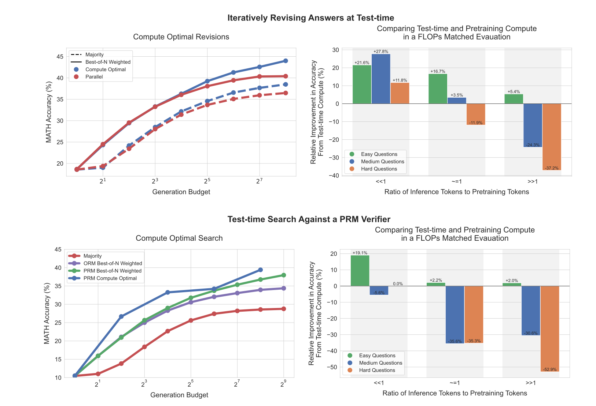
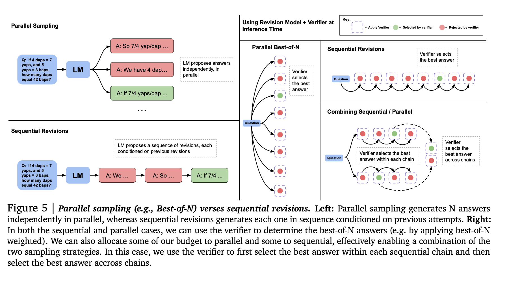
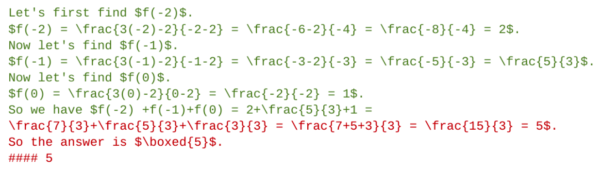
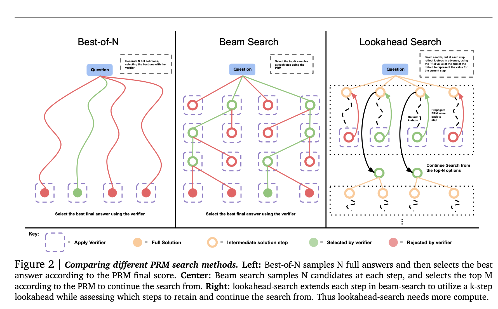
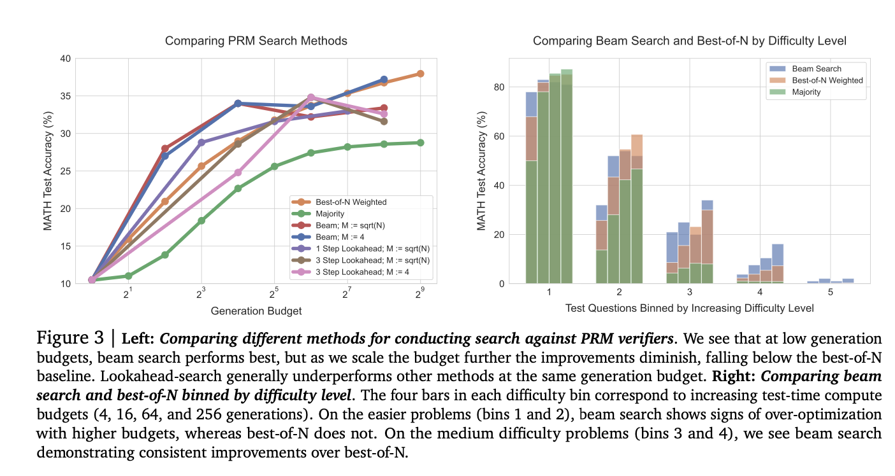
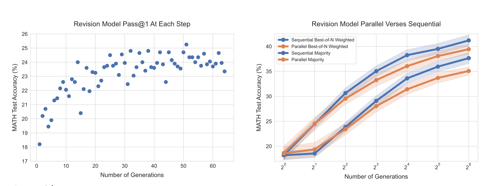
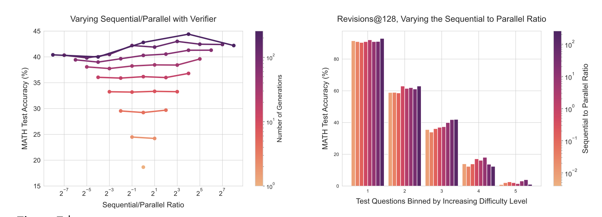

# Scaling LLM Test-Time Compute Optimally can be More Effective than Scaling Model Parameters

- **著者**: Charlie Snell, Jaehoon Lee, Kelvin Xu, Aviral Kumar
- **機関**: UC Berkeley, Google DeepMind
- **研究テーマ**: テスト時計算の最適スケーリング

---

# 1. Introduction

## 主題

- 大規模言語モデル（LLMs）のテスト時計算を増やすことで、性能をどの程度向上できるのか？
- 事前学習とテスト時計算のトレードオフはどうあるべきか？

## 背景

- LLMs は事前学習（Pretraining）に大量の計算リソースを要する。
- テスト時の計算量（Test-time compute）を最適化すれば、小規模モデルでも大規模モデル並みの性能を達成できる可能性がある。

---

# 本研究の貢献

- テスト時計算のスケール方法を分析：
  1. 逐次修正（Sequential Revisions）: 回答を修正しながら精度を向上。
  2. 並列探索（Parallel Sampling with Verifiers）: 多様な回答を生成し、最適なものを選択。
- Compute-Optimal 戦略の提案：
  - 問題の難易度ごとに推論時の計算を最適に割り当てる。
- 事前学習 vs テスト時計算の比較：
  - 一定の条件下では、小規模モデル＋テスト時計算が大規模モデルを上回る可能性を示す。

---

---

# 2. A Unified Perspective on Test-Time Computation

- テスト時計算の2つの主要手法
  - 提案分布の修正（Proposal Distribution Modification）
    - モデルの出力分布を変更し、逐次的に修正することで精度を向上。
    - 例: 逐次修正（Sequential Revisions）。
  - 検証器（Verifier）による探索（Search with Verifiers）
    - PRM（Process Reward Model）や ORM（Outcome Reward Model）を活用し、最適な回答を選択。
    - 例: 並列探索（Parallel Sampling with Verifiers）。
---

---

# 3. How to Scale Test-Time Computation Optimally

- 問題設定
  - 限られたテスト時計算のリソースの中で、どのように計算量を割り当てるべきか？
  - 事前学習でモデルを大きくするのと、テスト時計算を増やすのはどちらが効果的か？
- Compute-Optimal戦略
  - 問題の難易度に基づいてテスト時計算を動的に割り当てる。
  - 具体例:
    - 簡単な問題: 逐次修正が効果的。
    - 難しい問題: 並列探索が有効。
    - 中難易度の問題: 逐次修正と並列探索を組み合わせる。

---

# 4. Experimental Setup

### 使用データ
- **MATH Benchmark**（数学問題）
  - 高校レベルの数学問題を含むデータセット（12Kの訓練データ、500のテストデータ）。

### 使用モデル
- **PaLM-2 S\***（Google DeepMindのLLM）
  - 逐次修正（Sequential Revisions）と検証モデル（PRM/ORM）向けにファインチューニング済み。

---

# 5. Scaling Test-Time Compute via Verifiers

### 主な手法
- **PRM（Process Reward Model）**: 各推論ステップ（CoTのステップ）を評価。
- **ORM（Outcome Reward Model）**: 回答全体の正確性のみを評価。

---

# 5. Scaling Test-Time Compute via Verifiers

### 検索アルゴリズム
1. **Best-of-N Weighted**: いくつかの回答を生成し、最もスコアの高いものを選択。
2. **Beam Search**: 候補を絞りながら探索を行う。
3. **Lookahead Search**: 複数ステップ先を見越した探索を行う。

---

---

# 5. Scaling Test-Time Compute via Verifiers

### 結果
- **低い生成数**では Beam Search が効果的だが、生成数が増えると効果が低下。
- **難しい問題では Beam Search が有効だが、簡単な問題では Best-of-N が優位。**

---

# 6. Refining the Proposal Distribution

### 修正モデル（Sequential Revisions）の学習方法
- 質問文 + 誤った回答 を入力として学習。
- 正しい回答を出力 するようにファインチューニング。

---

# 6. Refining the Proposal Distribution

### 結果
- 修正回数を増やすと精度が向上（Pass@1の改善）。
- 並列生成よりも少ない計算リソースで高精度を達成。

---

# Compute-Optimal戦略におけるSequentialとParallelの使い分け

- 左図: 生成数（Generation Budget）と精度の関係
- 右図: 問題の難易度ごとの最適なバランス

---

# 7. Putting it Together: Exchanging Pretraining and Test-Time Compute

### 事前学習とテスト時計算の比較
- **FLOPs（計算量）の観点で、事前学習とテスト時計算のバランスを評価。**
- **R = 推論トークン数 ÷ 事前学習トークン数** で最適な配分を決定。

### 結果
- **Rが小さい場合（小規模利用）**: テスト時計算を増やす方が効率的。
- **Rが大きい場合（大規模利用）**: 事前学習をスケールする方が適切。

---

# 8. Discussion and Future Work

### 主な知見
1. **Sequential RevisionsとParallel Samplingは補完的**。
2. **Compute-Optimal戦略により、テスト時計算の効率を最大化可能**。
3. **事前学習とテスト時計算のバランスを最適化することで、小規模モデルの可能性を広げられる**。

### 今後の課題
- 難易度推定のさらなる最適化
  - 問題の難易度をより効率的に推定し、計算リソースを動的に割り当てる。
- テスト時計算の知見を事前学習に活かす
  - 推論時の学習を事前学習にフィードバックし、自己改良を実現する。

---

# 結論

- **この研究では、テスト時計算を動的にスケールすることで、モデルの性能を最大化する方法を提案した。**
- **特に、修正モデル（Sequential Revisions）と並列探索（Parallel Sampling with Verifiers）の組み合わせが鍵となる。**
- **今後は、難易度推定や学習フィードバックを活用し、テスト時計算のさらなる最適化が求められる。**

